# Hi there, I'm Thiago Mohr 👋

### Systems Coordinator & Backend / Mobile Engineer

I specialize in backend architecture and system coordination, building scalable, reliable applications with **Java, Spring Boot, Go, and Python**, alongside cross-platform mobile experiences with **Flutter**.

---

### 💼 About Me

- 🔭 **Currently working on:** Scalable backend architecture and leading system coordination initiatives
- 🏢 **Industry domains:** Healthcare Systems, Digital Games, Financial Services, Retail Technology
- 📜 **Certification:** **CAPM®** — Certified Associate in Project Management (PMI)
- 🌱 **Currently exploring:** Cloud-native solutions on AWS and AI-assisted software engineering with Claude Code
- 💬 **Ask me about:** Java / Spring Boot ecosystems, Go CLI & concurrency tooling, system architecture, project management, and Flutter
- ⚡ **Fun fact:** I balance system coordination with regular weightlifting training sessions!

---

### 🚀 Featured Projects

| Project | Description | Stack |
| :--- | :--- | :--- |
| [**dockclean-smart**](https://github.com/thiagomohrs/dockclean-smart) | Smart CLI tool for identifying unused Docker images | `Go` `Docker` `CLI` |
| [**sqldiff-fast**](https://github.com/thiagomohrs/sqldiff-fast) | High-performance concurrent SQL dump analyzer and diff tool using goroutines | `Go` `SQL` `Concurrency` |
| [**opr-multas-app**](https://github.com/thiagomohrs/opr-multas-app) | Application built in Java | `Java` |
| [**thiagomohrs.github.io**](https://github.com/thiagomohrs/thiagomohrs.github.io) | Personal website and portfolio | `HTML` `GitHub Pages` |

---

### 🛠️ Tech Stack & Tools

**Languages & Frameworks**  

**Cloud, Messaging & Data**  

**Tools & Management**  

---

### 📊 GitHub Stats

  
  

<!--
  github-cool-readme (https://github.com/pedrocatalao/github-cool-readme)
  After adding the CARDS_TOKEN secret and running the "Update README cards" workflow once,
  replace the 
 block above with the animated cards below:

  <picture>
    <source media="(prefers-color-scheme: dark)" srcset="https://raw.githubusercontent.com/thiagomohrs/thiagomohrs/cards/about-dark.svg">
    
  </picture>
  <picture>
    <source media="(prefers-color-scheme: dark)" srcset="https://raw.githubusercontent.com/thiagomohrs/thiagomohrs/cards/summary-dark.svg">
    
  </picture>

  <picture>
    <source media="(prefers-color-scheme: dark)" srcset="https://raw.githubusercontent.com/thiagomohrs/thiagomohrs/cards/languages-dark.svg">
    
  </picture>
  <picture>
    <source media="(prefers-color-scheme: dark)" srcset="https://raw.githubusercontent.com/thiagomohrs/thiagomohrs/cards/weekly-dark.svg">
    
  </picture>

-->
